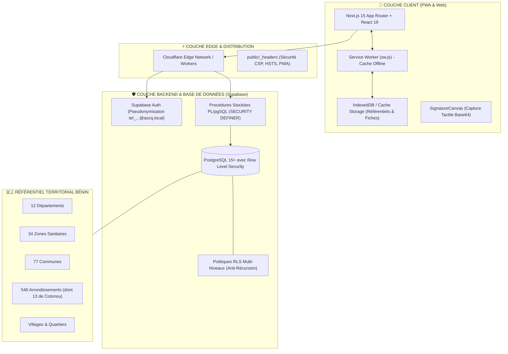

# DOSSIER TECHNIQUE D'ARCHITECTURE & D'AUDIT COMPLET
## SYSTÈME NUMÉRIQUE INTÉGRÉ DE SANTÉ COMMUNAUTAIRE : « ASCQ BÉNIN »

**Destinataire de l'audit** : Claude (Anthropic) / Auditeur Indépendant / Direction Départementale de la Santé (DDS) / Ministère de la Santé de la République du Bénin  
**Auteur & Responsable Institutionnel** : Bruno DOSSOU (Infirmier DE, Agent de Santé Communautaire Qualifié - ASCQ, Super Administrateur National)  
**Version de la plateforme** : 1.0.0 (Phase 11 - Prêt pour Production & Agrément Officiel)  
**Dépôt du code source** : `https://github.com/dossoubruno34-hue/ascq-benin.git`  
**Environnement de déploiement** : Cloudflare Pages / Workers (Edge Network Mondial) & Supabase PostgreSQL (Frankfurt / AWS)  
**Date du présent document** : 27 Octobre 2026  

---



---

## SOMMAIRE EXÉCUTIF

1. [Contexte Institutionnel & Enjeux Sanitaires au Bénin](#1-contexte-institutionnel--enjeux-sanitaires-au-bénin)
2. [Architecture Technique & Stack Technologique](#2-architecture-technique--stack-technologique)
3. [Référentiel Territorial & Sanitaire Officiel](#3-référentiel-territorial--sanitaire-officiel)
4. [Schéma de Données Détaillé (Dictionnaire des 17 Tables)](#4-schéma-de-données-détaillé-dictionnaire-des-17-tables)
5. [Sécurité, Authentification & Modèle RLS (Row Level Security)](#5-sécurité-authentification--modèle-rls-row-level-security)
6. [Catalogue des Procédures Stockées & Fonctions Métier (RPC)](#6-catalogue-des-procédures-stockées--fonctions-métier-rpc)
7. [Spécifications Fonctionnelles Détaillées par Module](#7-spécifications-fonctionnelles-détaillées-par-module)
8. [Mode Hors-Ligne (PWA) & Résilience en Zone Rurale](#8-mode-hors-ligne-pwa--résilience-en-zone-rurale)
9. [Conformité Épidémiologique, DHIS2, OMS & Formats d'Export](#9-conformité-épidémiologique-dhis2-oms--formats-dexport)
10. [Grille d'Audit Recommandée pour Claude & Auditeurs Tiers](#10-grille-daudit-recommandée-pour-claude--auditeurs-tiers)

---

## 1. CONTEXTE INSTITUTIONNEL & ENJEUX SANITAIRES AU BÉNIN

### 1.1 La Politique Nationale de Santé Communautaire (PNSC)
En République du Bénin, le Ministère de la Santé a structuré les interventions sanitaires de base autour de la **Politique Nationale de Santé Communautaire (PNSC)**. Ce dispositif repose sur un maillage serré :
- **L'Agent de Santé Communautaire Qualifié (ASCQ)** : Infirmier(ère) ou Sage-Femme diplômé(e) d'État, affecté(e) à un arrondissement sanitaire pour superviser la santé communautaire, assurer la surveillance épidémiologique intégrée (SIMR), investiguer les alertes sanitaires, former et encadrer les relais.
- **Le Relais Communautaire (RC)** : Leader communautaire résidant dans le village ou quartier de ville, chargé du suivi quotidien des ménages, de la promotion des pratiques familiales essentielles (PFE), de la recherche active des femmes enceintes et des enfants non vaccinés, et de la notification immédiate des rumeurs sanitaires.
- **Le ratio standard** : 1 ASCQ encadre en moyenne **16 Relais Communautaires** (jusqu'à 32 en cas de cumul exceptionnel de deux arrondissements).

### 1.2 Sources de Financement Institutionnelles
La plateforme modélise et trace les sources de financement étatiques et internationales finançant les activités des agents :
1. **LLF (Lives and Livelihoods Fund)** : Financement multilatéral pour le renforcement du système de santé communautaire.
2. **LLF-FADEC** : Fonds d'Appui au Développement des Communes, volet santé.
3. **SRHR (Sexual and Reproductive Health and Rights)** : Financement axé sur la santé reproductive, maternelle et néonatale.
4. **AUTRE** : Partenaires bilatéraux (USAID, Fonds Mondial, Enabel, UNICEF, OMS).

---

## 2. ARCHITECTURE TECHNIQUE & STACK TECHNOLOGIQUE

| Composant | Technologie retenue | Version | Justification technique |
| :--- | :--- | :--- | :--- |
| **Framework Web** | Next.js (App Router) | `15.5.28` | Prerendering statique, dynamic routes serveur, performances Edge et compatibilité PWA native. |
| **Moteur d'interface** | React / React-DOM | `19.0.0` | Nouvelles fonctionnalités de gestion d'état et transitions asynchrones sans blocage UI. |
| **Langage** | TypeScript | `5.8.2` | Typage strict de l'ensemble des structures de données sanitaires et contrats d'API. |
| **Styles & Responsive** | Tailwind CSS / PostCSS | `3.4.17` | Approche mobile-first ultra-légère optimisée pour les smartphones d'entrée de gamme des agents. |
| **Iconographie** | Lucide React | `1.16.0` | Pack d'icônes SVG optimisé par tree-shaking, ultra-léger et standardisé. |
| **Signature Tactile** | HTML5 Canvas | Custom | Capture locale des signatures de l'investigateur et du chef de village (format Base64 PNG). |
| **Base de Données** | PostgreSQL sous Supabase | `15+` | Moteur relationnel robuste avec intégrité référentielle, types UUID, JSONB et triggers d'audit. |
| **Sécurité Données** | Supabase Row Level Security | Natif | Filtrage déclaratif niveau ligne (RLS) basé sur le token JWT de l'agent authentifié. |
| **Authentification** | Supabase Auth (GoTrue) | `@supabase/supabase-js 2.118` | Authentification pseudonymisée basée sur le numéro de téléphone officiel béninois. |
| **Déploiement Edge** | Cloudflare Workers & Pages | OpenNext | Réseau mondial de serveurs mandataires assurant une latence minimale au Bénin (< 50 ms via Cotonou POP). |
| **Mode Offline** | Service Worker (Cache-First) | Cache API | Cache intégral du shell de l'application, des référentiels géographiques et des formulaires d'enquête. |

---

## 3. RÉFÉRENTIEL TERRITORIAL & SANITAIRE OFFICIEL

Le système intègre l'ensemble de la nomenclature officielle du Ministère de la Santé et du Ministère de la Décentralisation :

```
RÉPUBLIQUE DU BÉNIN
└── 12 Départements (Atacora, Alibori, Atlantique, Borgou, Collines, Couffo, Donga, Littoral, Mono, Ouémé, Plateau, Zou)
    └── 34 Zones Sanitaires (Ex: Abomey-Calavi/Sô-Ava, Cotonou 1-4, Ouinhi/Covè/Zagnanado, etc.)
        └── 77 Communes
            └── 546 Arrondissements
                ├── Reste du territoire (Ex: Arrondissement de Tohouès, Commune de Ouinhi, Zou)
                └── Spécificité Littoral : Cotonou
                    └── 13 Arrondissements urbains (1er au 13ème) regroupant 165 Quartiers officiels
```

### Règles territoriales appliquées :
1. **Intégrité stricte** : Aucune saisie libre de commune ou d'arrondissement. Toutes les fiches sont rattachées par clé étrangère UUID aux tables normalisées `departements`, `communes`, `arrondissements`.
2. **Double Arrondissement** : En cas de vacance de poste, un ASCQ peut être autorisé par décision administrative à couvrir un second arrondissement limitrophe (`second_arrondissement_id`).
3. **Isolation Cotonou** : Les 13 arrondissements de Cotonou disposent d'un gestionnaire de découpage spécifique permettant la répartition dynamique des 165 quartiers entre les équipes d'intervention rapide.

---

## 4. SCHÉMA DE DONNÉES DÉTAILLÉ (DICTIONNAIRE DES 17 TABLES)

### 4.1 Tables de Référence Géographique & Sanitaire

#### `public.departements`
- `id` : UUID (PK, `gen_random_uuid()`)
- `nom` : TEXT UNIQUE NOT NULL (12 départements béninois avec gestion insensible aux accents)
- `code` : TEXT UNIQUE

#### `public.zones_sanitaires`
- `id` : UUID (PK)
- `nom` : TEXT NOT NULL
- `code` : TEXT UNIQUE
- `departement_id` : UUID REFERENCES `departements(id)`

#### `public.communes`
- `id` : UUID (PK)
- `departement_id` : UUID NOT NULL REFERENCES `departements(id)`
- `zone_sanitaire_id` : UUID REFERENCES `zones_sanitaires(id)`
- `nom` : TEXT NOT NULL
- `alias` : TEXT

#### `public.arrondissements`
- `id` : UUID (PK)
- `commune_id` : UUID NOT NULL REFERENCES `communes(id)`
- `zone_sanitaire_id` : UUID REFERENCES `zones_sanitaires(id)`
- `nom` : TEXT NOT NULL
- `statut_arrondissement` : TEXT DEFAULT `'OFFICIEL'`
- `statut_zone_sanitaire` : TEXT DEFAULT `'OFFICIEL'`

#### `public.villages`
- `id` : UUID (PK)
- `arrondissement_id` : UUID NOT NULL REFERENCES `arrondissements(id)`
- `nom` : TEXT NOT NULL (Nom officiel du village ou quartier de ville)
- `code` : TEXT

#### `public.structures_sante`
- `id` : UUID (PK)
- `commune_id` : UUID NOT NULL REFERENCES `communes(id)`
- `arrondissement_id` : UUID REFERENCES `arrondissements(id)`
- `nom` : TEXT NOT NULL (Ex: `CSA OUINHI`, `HOPITAL DE ZONE DE COVE`)
- `type_structure` : TEXT CHECK (`'CSA'`, `'POSTE_SANTE'`, `'HOPITAL_ZONE'`, `'CHD'`, `'CNHU'`)

---

### 4.2 Tables Utilisateurs, Profils & Réseau Communautaire

#### `public.utilisateurs`
Table centrale des agents identifiés dans le système.
```sql
CREATE TABLE public.utilisateurs (
    id UUID PRIMARY KEY, -- Aligné sur auth.users.id
    telephone TEXT UNIQUE NOT NULL, -- Format béninois e.g. +229044485650
    nom TEXT NOT NULL,
    prenoms TEXT NOT NULL,
    poste TEXT NOT NULL CHECK (poste IN ('ASCQ', 'RC', 'PF_CCLS_TP', 'RCSE', 'CCD_CNLS_TP', 'AUTRE')),
    poste_autre TEXT,
    role_technique TEXT NOT NULL DEFAULT 'PUBLIC' CHECK (role_technique IN (
        'PUBLIC', 'RELAIS', 'ASCQ_OPERATEUR', 'GESTIONNAIRE_PERIMETRE', 
        'ADMIN_COMMUNAL', 'ADMIN_DEPARTEMENTAL', 'ADMINISTRATEUR', 'SUPER_ADMIN'
    )),
    statut_compte TEXT NOT NULL DEFAULT 'EN_ATTENTE' CHECK (statut_compte IN ('EN_ATTENTE', 'VALIDE', 'SUSPENDU', 'REJETE')),
    departement_id UUID REFERENCES public.departements(id),
    zone_sanitaire_id UUID REFERENCES public.zones_sanitaires(id),
    commune_id UUID REFERENCES public.communes(id),
    arrondissement_id UUID REFERENCES public.arrondissements(id),
    structure_sante_id UUID REFERENCES public.structures_sante(id),
    date_validation TIMESTAMPTZ,
    valide_par UUID REFERENCES public.utilisateurs(id),
    created_at TIMESTAMPTZ DEFAULT NOW(),
    updated_at TIMESTAMPTZ DEFAULT NOW()
);
```

#### `public.ascq_profils`
Attributs opérationnels et organisationnels propres à chaque ASCQ.
- `id` : UUID PRIMARY KEY REFERENCES `utilisateurs(id)` ON DELETE CASCADE
- `source_financement` : TEXT CHECK (`'LLF'`, `'LLF_FADEC'`, `'SRHR'`, `'AUTRE'`)
- `source_financement_autre` : TEXT
- `second_arrondissement_id` : UUID REFERENCES `arrondissements(id)`
- `cumul_deux_arrondissements` : BOOLEAN DEFAULT FALSE
- `nombre_rc` : INTEGER NOT NULL DEFAULT 16
- `afficher_annuaire_public` : BOOLEAN DEFAULT TRUE

#### `public.ascq_profil_prive` (Cloisonnement RGPD)
- `id` : UUID PRIMARY KEY REFERENCES `utilisateurs(id)` ON DELETE CASCADE
- `numero_npi` : TEXT (Numéro Personnel d'Identification national de l'ANIP - crypté)
- `diplome_obtenu` : TEXT
- `date_prise_service` : DATE
- `contact_urgence` : TEXT

#### `public.relais_communautaires`
Registre des 16 Relais Communautaires rattachés à chaque ASCQ.
- `id` : UUID PRIMARY KEY DEFAULT gen_random_uuid()
- `ascq_id` : UUID NOT NULL REFERENCES `utilisateurs(id)` ON DELETE CASCADE
- `user_id` : UUID REFERENCES `utilisateurs(id)` ON DELETE SET NULL
- `nom` : TEXT NOT NULL
- `prenoms` : TEXT NOT NULL
- `telephone` : TEXT NOT NULL
- `sexe` : TEXT CHECK (`'M'`, `'F'`)
- `arrondissement_id` : UUID NOT NULL REFERENCES `arrondissements(id)`
- `village_id` : UUID REFERENCES `villages(id)`
- `village_nom` : TEXT NOT NULL
- `nombre_menages_couverts` : INTEGER DEFAULT 0
- `est_actif` : BOOLEAN DEFAULT TRUE
- `code_temporaire` : TEXT
- `code_temporaire_utilise` : BOOLEAN DEFAULT FALSE
- `date_enrolement` : DATE DEFAULT CURRENT_DATE

---

### 4.3 Tables de Surveillance Épidémiologique (5 Fiches Officielles)

#### `public.alertes_communautaires` (Fiche 1 : Alerte Sanitaire d'Urgence)
- `id` : UUID PRIMARY KEY DEFAULT gen_random_uuid()
- `numero_alerte` : TEXT UNIQUE NOT NULL (Format : `ALR-AAAA-XXXXXX`)
- `annee` : INTEGER NOT NULL
- `semaine_epidemio` : INTEGER NOT NULL (Semaine 1 à 53 selon standard OMS)
- `mois` : INTEGER NOT NULL
- `date_notification` : DATE NOT NULL DEFAULT CURRENT_DATE
- `date_debut_maladie` : DATE
- `heure_survenue` : TIME
- `date_detection` : DATE NOT NULL DEFAULT CURRENT_DATE
- `heure_detection` : TIME
- `delai_detection_notification_heures` : NUMERIC
- `departement_id`, `commune_id`, `arrondissement_id`, `village_id`
- `lieu_dit` : TEXT
- `type_alerte_id` : UUID REFERENCES `types_alertes_reference(id)`
- `type_alerte_nom` : TEXT NOT NULL (Choléra, Rougeole, Fièvre Lassa, Méningite, PFA, Mpox, etc.)
- `description_faits` : TEXT NOT NULL
- `nb_personnes_touchees` : INTEGER DEFAULT 1
- `nb_deces` : INTEGER DEFAULT 0
- `sexe` : TEXT CHECK (`'M'`, `'F'`)
- `age_valeur` : INTEGER, `age_unite` : TEXT CHECK (`'JOURS'`, `'MOIS'`, `'ANS'`)
- `notificateur_id` : UUID NOT NULL REFERENCES `utilisateurs(id)`
- `notificateur_nom_complet` : TEXT NOT NULL
- `notificateur_titre` : TEXT NOT NULL (`'ASCQ'` ou `'RC'`)
- `notificateur_telephone` : TEXT NOT NULL
- `centre_sante_nom` : TEXT
- `signature_tactile` : TEXT (Base64)
- `ascq_superviseur_id` : UUID REFERENCES `utilisateurs(id)`
- `statut` : TEXT DEFAULT `'NOTIFIEE'` CHECK (`'NOTIFIEE'`, `'RECUE'`, `'VERIFIEE'`, `'INVESTIGUEE'`, `'CLOTUREE'`, `'REJETEE'`)
- `resultat_verification` : TEXT DEFAULT `'EN_ATTENTE'` CHECK (`'EN_ATTENTE'`, `'AVEREE'`, `'NON_AVEREE'`)
- `date_verification` : TIMESTAMPTZ
- `verifie_par` : UUID REFERENCES `utilisateurs(id)`
- `cause_cim10_code` : TEXT (Ex: `A00.9`, `B05.9`)

#### `public.registre_alertes_rumeurs` (Fiche 2 : Registre Journalier des Rumeurs)
- `id` : UUID PRIMARY KEY DEFAULT gen_random_uuid()
- `numero_registre` : TEXT UNIQUE NOT NULL (Format : `REG-AAAA-XXXXXX`)
- `date_reception` : DATE NOT NULL DEFAULT CURRENT_DATE
- `heure_reception` : TIME
- `source_information` : TEXT CHECK (`'RELAIS'`, `'POPULATION'`, `'LEADER_RELIGIEUX'`, `'CHEF_VILLAGE'`, `'AUTRE'`)
- `source_nom`, `source_contact` : TEXT
- `arrondissement_id`, `village_nom`, `lieu_dit` : TEXT
- `evenement_signale` : TEXT NOT NULL
- `signes_observes` : TEXT[]
- `mesures_urgentes_prises` : TEXT
- `statut_traitement` : TEXT CHECK (`'EN_COURS'`, `'INVESTIGUE'`, `'TRANSMIS_CSA'`, `'CLASSE_SANS_SUITE'`)
- `relais_id` : UUID REFERENCES `utilisateurs(id)`
- `ascq_superviseur_id` : UUID REFERENCES `utilisateurs(id)`

#### `public.deces_communautaires` (Fiche 3 : Surveillance des Décès & Autopsie Verbale)
- `id` : UUID PRIMARY KEY DEFAULT gen_random_uuid()
- `numero_deces` : TEXT UNIQUE NOT NULL (Format : `DEC-AAAA-XXXXXX`)
- `date_deces` : DATE NOT NULL
- `date_notification` : DATE NOT NULL DEFAULT CURRENT_DATE
- `sexe` : TEXT CHECK (`'M'`, `'F'`)
- `age_valeur` : INTEGER, `age_unite` : TEXT CHECK (`'JOURS'`, `'MOIS'`, `'ANS'`)
- `femme_enceinte` : BOOLEAN DEFAULT FALSE
- `deces_maternel` : BOOLEAN DEFAULT FALSE
- `lieu_deces` : TEXT CHECK (`'DOMICILE'`, `'CENTRE_SANTE'`, `'VOIE_PUBLIQUE'`, `'CHAMPS'`, `'AUTRE'`)
- `arrondissement_id`, `village_nom`
- `symptomes_avant_deces` : TEXT[]
- `soins_recus_avant_deces` : TEXT
- `cause_presumee` : TEXT NOT NULL
- `cause_validee_par` : UUID REFERENCES `utilisateurs(id)`
- `notificateur_id` : UUID REFERENCES `utilisateurs(id)`
- `ascq_superviseur_id` : UUID REFERENCES `utilisateurs(id)`

#### `public.investigations_alertes` (Fiche 4 : Investigation Épidémiologique Approfondie)
- `id` : UUID PRIMARY KEY DEFAULT gen_random_uuid()
- `numero_investigation` : TEXT UNIQUE NOT NULL (Format : `INV-AAAA-XXXXXX`)
- `alerte_id` : UUID REFERENCES `alertes_communautaires(id)`
- `date_investigation` : DATE NOT NULL DEFAULT CURRENT_DATE
- `investigateur_id` : UUID NOT NULL REFERENCES `utilisateurs(id)`
- `investigateur_nom` : TEXT NOT NULL
- `investigateur_titre` : TEXT NOT NULL DEFAULT 'ASCQ'
- `hypothese_diagnostique` : TEXT NOT NULL
- `echantillons_preleves` : BOOLEAN DEFAULT FALSE
- `nature_prelevement` : TEXT
- `contacts_recenses` : INTEGER DEFAULT 0
- `contacts_mis_en_quarantaine` : INTEGER DEFAULT 0
- `mesures_barriere_appliquees` : TEXT[]
- `signature_investigateur` : TEXT (Base64 Canvas)
- `signature_autorite_locale` : TEXT (Base64 Canvas - Chef de village / élu)

#### `public.rapports_hebdomadaires` (Fiche 5 : Synthèse Épidémiologique Hebdomadaire)
- `id` : UUID PRIMARY KEY DEFAULT gen_random_uuid()
- `numero_rapport` : TEXT UNIQUE NOT NULL (Format : `RAP-AAAA-SXX-XXXX`)
- `annee` : INTEGER NOT NULL
- `semaine_epidemio` : INTEGER NOT NULL CHECK (`semaine_epidemio BETWEEN 1 AND 53`)
- `ascq_id` : UUID NOT NULL REFERENCES `utilisateurs(id)`
- `arrondissement_id` : UUID NOT NULL REFERENCES `arrondissements(id)`
- `total_alertes_recues` : INTEGER DEFAULT 0
- `total_alertes_investiguees` : INTEGER DEFAULT 0
- `total_deces_notifies` : INTEGER DEFAULT 0
- `donnees_maladies` : JSONB (Tableau consolidé maladie par maladie : cas, hospitalisations, décès)
- `difficultes_rencontrees` : TEXT
- `besoins_urgents` : TEXT
- `statut_validation` : TEXT DEFAULT `'SOUMIS'` CHECK (`'BROUILLON'`, `'SOUMIS'`, `'VALIDE_MEDECIN'`, `'REJETE'`)
- `valide_par` : UUID REFERENCES `utilisateurs(id)`

---

### 4.4 Tables d'Animation, Pilotage & Rapports Mensuels

#### `public.planning_activites`
- `id` : UUID PRIMARY KEY DEFAULT gen_random_uuid()
- `ascq_id` : UUID NOT NULL REFERENCES `utilisateurs(id)` ON DELETE CASCADE
- `titre` : TEXT NOT NULL
- `type_activite` : TEXT CHECK (`'SUPERVISION_RELAIS'`, `'SENSIBILISATION'`, `'VACCINATION'`, `'CAUSERIE_EDUCATIVE'`, `'REUNION_COMMUNALE'`, `'AUTRE'`)
- `date_debut` : TIMESTAMPTZ NOT NULL, `date_fin` : TIMESTAMPTZ NOT NULL
- `lieu` : TEXT NOT NULL
- `statut` : TEXT DEFAULT `'PLANIFIEE'` CHECK (`'PLANIFIEE'`, `'EN_COURS'`, `'REALISEE'`, `'REPORTEE'`, `'ANNULEE'`)

#### `public.activites_menees`
- `id` : UUID PRIMARY KEY DEFAULT gen_random_uuid()
- `ascq_id` : UUID NOT NULL REFERENCES `utilisateurs(id)` ON DELETE CASCADE
- `type_activite` : TEXT NOT NULL
- `theme` : TEXT NOT NULL
- `date_realisation` : DATE NOT NULL DEFAULT CURRENT_DATE
- `arrondissement_id`, `village_nom`
- `nb_hommes` : INTEGER DEFAULT 0, `nb_femmes` : INTEGER DEFAULT 0, `nb_enfants` : INTEGER DEFAULT 0
- `resume` : TEXT NOT NULL

#### `public.suivis_relais`
- `id` : UUID PRIMARY KEY DEFAULT gen_random_uuid()
- `ascq_id` : UUID NOT NULL REFERENCES `utilisateurs(id)` ON DELETE CASCADE
- `relais_id` : UUID NOT NULL REFERENCES `relais_communautaires(id)` ON DELETE CASCADE
- `date_supervision` : DATE NOT NULL DEFAULT CURRENT_DATE
- `points_forts` : TEXT, `axes_amelioration` : TEXT
- `note_globale` : NUMERIC CHECK (`note_globale BETWEEN 0 AND 20`)

#### `public.rapports_mensuels` (RMA Officiel de Santé Communautaire)
- `id` : UUID PRIMARY KEY DEFAULT gen_random_uuid()
- `ascq_id` : UUID NOT NULL REFERENCES `utilisateurs(id)` ON DELETE CASCADE
- `annee` : INTEGER NOT NULL, `mois` : INTEGER NOT NULL CHECK (`mois BETWEEN 1 AND 12`)
- `arrondissement_id` : UUID NOT NULL REFERENCES `arrondissements(id)`
- `statut` : TEXT DEFAULT `'SOUMIS'` CHECK (`'BROUILLON'`, `'SOUMIS'`, `'VALIDE_DDS'`, `'REJETE'`)
- `indicateurs` : JSONB (Structure officielle regroupant :
  - *Santé Maternelle* : Femmes enceintes recensées, référées pour CPN, accouchements à domicile assistés / évacués.
  - *Santé Infantile* : Enfants dépistés pour malnutrition (PB), cas de paludisme pris en charge par TDR / CTA, diarrhée / SRO / Zinc.
  - *Surveillance* : Total alertes et décès communautaires du mois.
  - *Activité Relais* : Visites ménages réalisées par les 16 RC.)
- `date_soumission` : TIMESTAMPTZ DEFAULT NOW()

---

### 4.5 Tables Transversales, Écoute Citoyenne & Notifications

- `public.notifications` : `id`, `destinataire_id` (NULL pour diffusion générale), `titre`, `message`, `type`, `lu`, `created_at`.
- `public.activites_demandees_ascq` : Tâches et directives envoyées par la hiérarchie sanitaire (Médecin Coordonnateur, DDS) vers les ASCQ.
- `public.permutations_ascq` : Annonces et propositions de permutation géographique entre agents.
- `public.requetes_administratives` : Demandes d'attestation, dotation de matériel médical, requêtes de carburant et réclamations.
- `public.conseils_sante` : Bibliothèque de messages éducatifs grand public validés par la Direction Nationale de la Santé Publique.
- `public.suggestions_publiques` : Boîte citoyenne anonyme pour recueil des plaintes et appréciations des usagers de santé.

---

## 5. SÉCURITÉ, AUTHENTIFICATION & MODÈLE RLS (ROW LEVEL SECURITY)

### 5.1 Authentification par Numéro de Téléphone Pseudonymisé
Les agents de terrain au Bénin ne disposent pas tous d'une adresse email active et sécurisée. Le système résout ce défi en traduisant de manière transparente et déterministe le numéro de téléphone officiel en identifiant technique interne :

$$\text{Email technique} = \text{"tel\_"} + \text{chiffres\_du\_téléphone} + \text{"@ascq.local"}$$

*Exemple* : Pour le numéro `+229 04 44 85 650`, le système génère `tel_229044485650@ascq.local`.  
Le mot de passe de l'agent est haché selon l'algorithme cryptographique standard **bcrypt** avec sel sécurisé (`extensions.crypt`).

### 5.2 Résolution Définitive de l'Erreur de Récursion RLS (PostgreSQL 42P17)
Dans les versions antérieures, la vérification du rôle administratif via une sous-requête SQL directe sur `public.utilisateurs` provoquait une boucle infinie de politiques RLS.  
Ce dysfonctionnement a été **résolu de manière structurelle et permanente** :

1. **Fonction `public.est_administrateur()` en langage procédural `plpgsql`** :
   ```sql
   CREATE OR REPLACE FUNCTION public.est_administrateur()
   RETURNS BOOLEAN
   LANGUAGE plpgsql
   SECURITY DEFINER
   SET search_path = public
   AS $$
   DECLARE
     v_role TEXT;
   BEGIN
     IF auth.uid() IS NULL THEN
       RETURN FALSE;
     END IF;

     SELECT role_technique INTO v_role
     FROM public.utilisateurs
     WHERE id = auth.uid();

     RETURN v_role IN ('ADMINISTRATEUR', 'SUPER_ADMIN', 'ADMIN_DEPARTEMENTAL', 'ADMIN_COMMUNAL', 'GESTIONNAIRE_PERIMETRE');
   END;
   $$;
   ```
   *Bénéfice* : Le compilateur PostgreSQL n'effectue aucun inlining de la fonction, rompant définitivement le cycle de récursion.

2. **Politiques déclaratives sans interférence récursive** :
   ```sql
   -- Lecture : un utilisateur lit son profil + tous les profils validés sont visibles
   CREATE POLICY "Lecture utilisateurs securisee" ON public.utilisateurs
       FOR SELECT USING (
           auth.uid() = id OR
           statut_compte = 'VALIDE'
       );

   -- Lecture des profils ASCQ débloquée
   CREATE POLICY "Lecture profil ASCQ" ON public.ascq_profils
       FOR SELECT USING (true);
   ```

---

## 6. CATALOGUE DES PROCÉDURES STOCKÉES & FONCTIONS MÉTIER (RPC)

Toutes les opérations sensibles sont encapsulées dans des fonctions PostgreSQL `SECURITY DEFINER` vérifiant l'intégrité des règles métier :

| Nom de la procédure | Paramètres | Sortie | Description & Règles métier |
| :--- | :--- | :--- | :--- |
| `inscrire_nouvel_agent` | `p_id`, `p_telephone`, `p_nom`, `p_prenoms`, `p_commune_id`, `p_arrondissement_id`, `p_source_financement` | `BOOLEAN` | Crée simultanément l'utilisateur en statut `EN_ATTENTE` et initialise son `ascq_profils`. |
| `obtenir_mon_profil` | *Aucun (détecte `auth.uid()`)* | `TABLE` | Retourne l'identité, l'arrondissement, le département et le rôle de l'agent connecté. |
| `obtenir_mon_espace` | *Aucun (détecte `auth.uid()`)* | `JSONB` | Consolide les informations administratives, financières, le nombre de RC et le cumul de postes. |
| `lister_comptes_admin` | *Aucun* | `TABLE` | Liste l'ensemble des comptes créés pour le panneau de validation des administrateurs. |
| `changer_statut_compte` | `p_id`, `p_nouveau_statut` | `BOOLEAN` | Valide, suspend ou rejette un compte agent avec attribution du rôle technique adéquat. |
| `creer_nouvelle_alerte` | `p_alerte_json` | `JSONB` | Génère un numéro officiel chronologique `ALR-AAAA-XXXXXX`, calcule la semaine épidémiologique et notifie. |
| `lister_mes_alertes` | *Aucun* | `SETOF alertes_communautaires` | Renvoie les alertes de l'arrondissement sous la responsabilité de l'agent connecté. |
| `investiguer_alerte` | `p_alerte_id`, `p_hypothese`, `p_contacts`, `p_signature_base64` | `BOOLEAN` | Enregistre l'investigation, change le statut de l'alerte en `INVESTIGUEE` et journalise l'auteur. |
| `obtenir_statistiques_tableau_de_bord` | `p_departement_id`, `p_commune_id` | `JSONB` | Calcule en temps réel : alertes totales, avérées, taux d'investigation, délai moyen en heures, décès. |
| `exporter_donnees_surveillance_anonymisees`| `p_annee`, `p_semaine_debut`, `p_semaine_fin` | `TABLE` | Exporte les alertes sans NPI ni coordonnées privées, au format standard SIMR/DHIS2. |

---

## 7. SPÉCIFICATIONS FONCTIONNELLES DÉTAILLÉES PAR MODULE

```
ARCHITECTURE MODULAIRE DE L'APPLICATION ASCQ BÉNIN
├── 1. Portail Public & Vitrine Institutionnelle (/)
├── 2. Authentification & Inscription (/connexion, /inscription)
├── 3. Espace Agent de Terrain - ASCQ (/espace-ascq)
│   ├── Fiche Personnelle & Statuts (/espace-ascq)
│   ├── Réseau des 16 Relais Communautaires (/espace-ascq/relais)
│   ├── Supervision & Suivi des RC (/espace-ascq/suivi-relais)
│   ├── Planning & Activités (/espace-ascq/planning, /espace-ascq/activites-menees)
│   ├── Rapport Mensuel d'Activité RMA (/espace-ascq/rapport-mensuel)
│   ├── Permutations Territoriales (/espace-ascq/permutations)
│   ├── Requêtes Administratives (/espace-ascq/requetes)
│   └── Bibliothèque Protocoles Sanitaires (/espace-ascq/bibliotheque)
├── 4. Surveillance Épidémiologique (/fiches)
│   ├── Alerte Sanitaire d'Urgence (/fiches/alerte/nouvelle, /fiches/alerte/[id])
│   ├── Registre Journalier des Rumeurs (/fiches/registre/nouvelle)
│   ├── Surveillance des Décès Communautaires (/fiches/deces/nouvelle)
│   ├── Fiche d'Investigation Approfondie (/fiches/investigation/nouvelle)
│   └── Rapport Hebdomadaire SIMR (/fiches/rapport-hebdo/nouvelle)
├── 5. Espace Relais Communautaire (/espace-rc, /relais/premiere-connexion)
└── 6. Portail de Commandement Super Administrateur (/admin)
    ├── Tableau de bord épidémiologique temps réel
    ├── Validation & Gestion des Comptes (/admin/validation-comptes)
    ├── Périmètre d'Activités & Directives Nationales
    ├── Permutations & Requêtes d'Appui
    ├── Diffusion d'Alertes Sanitaires d'Urgence (SMS/Push)
    ├── Écoute Citoyenne & Conseils Santé
    ├── Référentiel Territorial Cotonou (13 Arr. / 165 Quartiers)
    └── Centre d'Exports Officiels (DDS / Ministère de la Santé)
```

### Module 1 : Authentification & Inscription Professionnelle
- **Inscription** : Formulaire à double volet vérifiant l'appartenance au corps des ASCQ. Sélection en cascade du Département $\to$ Zone Sanitaire $\to$ Commune $\to$ Arrondissement $\to$ Structure de Santé de rattachement.
- **Circuit d'approbation** : Tout compte créé est placé en `EN_ATTENTE`. Seul un Administrateur peut l'activer après vérification du diplôme et de l'affectation territoriale.

### Module 2 : Espace ASCQ & Gestion des 16 Relais
- L'ASCQ visualise l'état de son territoire (Commune, Arrondissement, Structure de Santé).
- **Enrôlement des 16 RC** : Saisie du nom, téléphone, village officiel, et nombre de ménages assignés.
- **Accès pour les Relais** : Le système génère un code temporaire sécurisé permettant au Relais de s'authentifier sur son smartphone sans mot de passe complexe lors de sa première utilisation.

### Module 3 : Les 5 Fiches de Surveillance Épidémiologique
1. **Fiche Alerte (ALR)** : Détection précoce des maladies à potentiel épidémique (MPE). Calcul automatique de la semaine épidémiologique OMS (lundi au dimanche) et du délai d'alerte en heures entre survenue et notification.
2. **Fiche Registre des Rumeurs (REG)** : Recueil des bruits communautaires et rumeurs de cas inhabituels.
3. **Fiche Décès Communautaire (DEC)** : Autopsie verbale communautaire, traçabilité rigoureuse des décès maternels (femme enceinte ou postpartum) pour le comité d'audit des décès maternels et néonatals.
4. **Fiche Investigation (INV)** : Remplie lors de la descente sur site. Hypothèses diagnostiques, recensement des contacts, mesures de quarantaine, et **double signature tactile** enregistrée sur écran tactile (l'ASCQ enquêteur et le Chef de village).
5. **Rapport Hebdomadaire (RAP)** : Tableau de bord de la semaine épidémiologique écoulée consolidant cas suspects et décès par pathologie.

### Module 4 : Rapport Mensuel d'Activité (RMA - Phase 9)
- Consolidation mensuelle obligatoire pour la transmission vers le Médecin Coordonnateur de Zone et la DDS.
- Automatisation des calculs statistiques (somme des alertes, récapitulatif des supervisions des 16 RC, taux de complétude).
- Export imprimable ou téléchargeable en format officiel.

### Module 5 : Portail d'Administration & Pilotage National (Phase 10)
- **Tableau de Bord National** : Vision géographique consolidée (taux d'investigation, alertes avérées, délais de réponse).
- **Validation des Comptes** : Tableau interactif avec filtre de recherche, consultation des coordonnées professionnelles et boutons 1-clic de validation / suspension.
- **Diffusion d'Urgence** : Module d'émission d'alertes instantanées vers l'ensemble des agents d'un département ou de tout le pays.
- **Exports Officiels** : Extraction Excel/CSV standardisée des données anonymisées pour alimentation du logiciel national **DHIS2**.

---

## 8. MODE HORS-LIGNE (PWA) & RÉSILIENCE EN ZONE RURALE

Les zones sanitaires du Bénin (ex: zones lacustres de Sô-Ava, communes enclavées de l'Atacora ou du Zou) connaissent des coupures fréquentes de réseau GSM/3G. La plateforme a été conçue selon le paradigme **Offline-First** :

1. **Service Worker (`public/sw.js`)** :
   - Mise en cache prédictive du shell d'application (`core-v1`).
   - Stratégie *Cache-First* pour les ressources statiques, feuilles de style et icônes.
   - Stratégie *Network-First avec Fallback Cache* pour les pages de formulaires.
2. **Web App Manifest (`public/manifest.json`)** :
   - Support complet de l'installation sur écran d'accueil Android et iOS (`display: standalone`).
   - Icônes vectorielles et bitmap normalisées (`icon-192.png`, `icon-512.png`).
   - Thème officiel aux couleurs nationales du Bénin (Vert `#005c30`, Jaune `#FCD116`, Rouge `#E8112D`).
3. **Enregistrement des fiches hors-ligne** :
   - En l'absence de réseau, les données saisies sont stockées dans le cache applicatif local (IndexedDB) avec statut `BROUILLON_LOCAL`.
   - Dès le retour de la connexion, le bouton de synchronisation transmet la fiche à Supabase sans risque de perte de données.

---

## 9. CONFORMITÉ ÉPIDÉMIOLOGIQUE, DHIS2, OMS & FORMATS D'EXPORT

### 9.1 Alignement sur les Directives OMS & SIMR
- **Numérotation unique normalisée** : Chaque événement de santé est identifié par un code inviolable (ex: `ALR-2026-000042`).
- **Semaines Épidémiologiques** : Algorithme de calcul conforme à la norme ISO-8601 adoptée par l'Organisation Mondiale de la Santé (la semaine 1 est celle qui contient le premier jeudi de l'année).
- **Codification CIM-10** : Association des alertes aux codes de la Classification Internationale des Maladies (ex: Choléra = `A00`, Rougeole = `B05`).

### 9.2 Formats d'Exportation DDS & Ministère
La procédure stockée `exporter_donnees_surveillance_anonymisees()` génère des flux prêts à l'import dans les plateformes de santé publique :
- **Format CSV normalisé** : Séparateur point-virgule, encodage UTF-8 avec BOM pour compatibilité native Microsoft Excel.
- **Anonymisation stricte** : Exclusion des numéros NPI, des identités nominatives des malades et des adresses privées. Seuls l'âge, le sexe, la date, l'arrondissement et la pathologie sont exportés.

---

## 10. GRILLE D'AUDIT RECOMMANDÉE POUR CLAUDE & AUDITEURS TIERS

Lors de la revue de ce dossier et du code source, nous invitons Claude et tout auditeur indépendant à examiner spécifiquement les 6 piliers ci-dessous :

| Pilier d'Audit | Critères de Conformité Évalués | Fichiers de Référence dans le Dépôt |
| :--- | :--- | :--- |
| **1. Robustesse RLS & Données** | Absence totale de récursion infinie ; isolation stricte des données privées ; intégrité référentielle en cas de suppression. | `supabase/migrations/20261026_attribution_admin_bruno.sql`<br>`supabase/migrations/20261027_nettoyage_comptes_tests.sql` |
| **2. Typage & Qualité de Code** | Typage TypeScript strict ; absence de `useSearchParams()` orphelin (encapsulation Suspense validée pour Next.js 15). | `src/app/fiches/investigation/nouvelle/page.tsx`<br>`src/components/AscqNav.tsx` |
| **3. Expérience Utilisateur & Fluidité** | Passerelle bidirectionnelle entre l'Espace ASCQ Terrain et le Portail Super Administrateur ; cohérence visuelle. | `src/app/connexion/page.tsx`<br>`src/app/admin/page.tsx` |
| **4. Fonctionnalité Hors-Ligne (PWA)** | Enregistrement du Service Worker ; validité du manifeste PWA ; accessibilité sans réseau internet. | `public/manifest.json`<br>`public/sw.js`<br>`src/components/ServiceWorkerRegister.tsx` |
| **5. Intégrité Territoriale Bénin** | Présence des 12 départements, 77 communes, 546 arrondissements et gestion spécifique des quartiers de Cotonou. | `supabase/migrations/20261025_phase2_fondations.sql`<br>`supabase/migrations/nettoyage_doublons_accents.sql` |
| **6. Auditabilité & Sauvegarde** | Procédures d'exportation complètes ; scripts de sauvegarde locale testés et reproductibles. | `scripts/test-phase11-securite-conformite.js`<br>`scripts/sauvegarde-base-supabase.js` |

---

### Conclusion de l'Auteur
> *« Ce système a été conçu sur le terrain, par un soignant béninois pour ses pairs et pour le système de santé de notre Nation. Chaque ligne de code et chaque table reflètent les réalités vécues dans nos arrondissements : la nécessité d'une réponse épidémiologique ultra-rapide, la simplicité de manipulation pour les relais, et la rigueur absolue des données transmises à notre Ministère de la Santé. »*  
> **— Bruno DOSSOU**, Infirmier DE, ASCQ (Ouinhi/Tohouès), Super Administrateur National.
