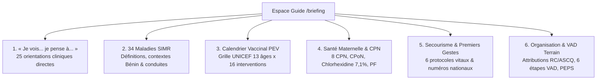
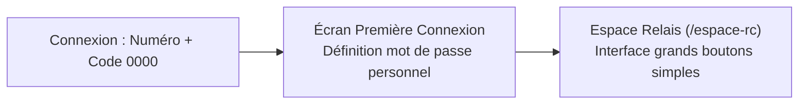

# Guide d'Utilisateur Officiel Détaillé par Profil — Plateforme ASCQ Bénin
**République du Bénin • Ministère de la Santé • Programme National de Santé Communautaire**  
*Version Officielle d'Exploitation : V3.0 | Actualisation : Octobre 2026*

---

## Sommaire Général
1. [Cadre Institutionnel & Principes Fondateurs](#1-cadre-institutionnel--principes-fondateurs)
2. [Socle Technique Commun & Expérience Utilisateur](#2-socle-technique-commun--expérience-utilisateur)
3. [Centre National de Référence Clinique & Guides SIMR/PEV (/briefing)](#3-centre-national-de-référence-clinique--guides-simrpev-briefing)
4. [Profil 1 : Super Administrateur National (Ex. : Bruno DOSSOU)](#4-profil-1--super-administrateur-national)
5. [Profil 2 : Administrateurs Nationaux & Cadres de Niveau Central](#5-profil-2--administrateurs-nationaux--cadres-de-niveau-central)
6. [Profil 3 : Cadres Départementaux (DDS, CSSPR, CSPSMEMH, CCD CDLS-TP)](#6-profil-3--cadres-départementaux)
7. [Profil 4 : Cadres de Zone Sanitaire (MCZS, RCSE, C-RAMS)](#7-profil-4--cadres-de-zone-sanitaire)
8. [Profil 5 : Représentants Communaux & Cadres Locaux (MCC, PF CCLS-TP)](#8-profil-5--représentants-communaux--cadres-locaux)
9. [Profil 6 : ASCQ (Agent de Santé Communautaire Qualifié)](#9-profil-6--ascq-agent-de-santé-communautaire-qualifié)
10. [Profil 7 : Relais Communautaire (RC de village)](#10-profil-7--relais-communautaire-rc)
11. [Profil 8 : Grand Public & Citoyens](#11-profil-8--grand-public--citoyens)
12. [Gestion du Personnel, Nettoyage des Données & Radiation](#12-gestion-du-personnel-nettoyage-des-données--radiation)
13. [Fiches Réflexes & Guide de Dépannage Technique](#13-fiches-réflexes--guide-de-dépannage-technique)

---

## 1. Cadre Institutionnel & Principes Fondateurs

La plateforme numérique **ASCQ Bénin** constitue l'outil officiel de coordination, de surveillance épidémiologique et de prise en charge clinique décentralisée du système de santé communautaire du Bénin.

Elle applique rigoureusement les dispositions des référentiels nationaux :
* **Guide de l'Agent de Santé Communautaire** (Présidence de la République du Bénin — CNLS-TP, Décembre 2020).
* **Guide Communautaire des Maladies sous Surveillance – Définitions de cas ASCQ & RC** (Ministère de la Santé / SIMR & PEV, Octobre 2026).
* **Politique Nationale de Santé Communautaire (PNSC)** et stratégie One Health.

---

## 2. Socle Technique Commun & Expérience Utilisateur

### A. Reconnaissance Universelle des Numéros Béninois (+229)
* L'application intègre un moteur de normalisation automatique au standard officiel : `+229 01 XX XX XX XX`.
* Tout numéro saisi par un agent (dans les fiches iCCM, les alertes, les inscriptions ou les carnets de ménage) est instantanément reconnu et mis en forme.
* **Boutons d'action devant chaque numéro** :
  * 🟢 **Bouton WhatsApp** : Ouvre directement une discussion WhatsApp pré-remplie vers l'interlocuteur.
  * 🔘 **Bouton Appel Direct** : Lance un appel téléphonique cellulaire standard.

### B. Permissions Initiales (GPS & Notifications Push)
Dès la toute première connexion d'un utilisateur sur smartphone, tablette ou ordinateur, une fenêtre de dialogue interactive sollicite deux autorisations majeures :
1. **Géolocalisation GPS** : Coordonnées (latitude, longitude, marge de précision) horodatées et attachées automatiquement à chaque acte clinique ou alerte.
2. **Notifications Mobiles Push** : Réception immédiate d'alertes sanitaires, directives officielles et ordres de mission, affichées sur l'écran verrouillé du smartphone comme un message WhatsApp ou Facebook.

### C. Mode Hors-Ligne & Synchronisation (PWA en Zone Rurale)
* La plateforme fonctionne sous la technologie **Progressive Web App (PWA)**.
* En l'absence de réseau au village (« zone blanche »), l'agent peut continuer à ouvrir ses fiches, saisir ses consultations iCCM, enregistrer des alertes et consulter les guides.
* Les données sont stockées de manière chiffrée dans la base locale du navigateur (IndexedDB).
* Dès le retour d'une connexion internet (Wi-Fi / 3G / 4G), l'indicateur passe au vert et synchronise automatiquement toutes les données en attente.

### D. Présence et Réseaux Sociaux Officiels
Retrouvez les canaux d'information officiels de l'ASCQ Bénin :
* **Threads** : [`@ascqbenin`](https://www.threads.com/@ascqbenin)
* **Instagram** : [`@ascqbenin`](https://www.instagram.com/ascqbenin?obrf=MXVkeWZ4MWNhYmZ5eA==)
* **X (ex-Twitter)** : [`@ascqbenin`](https://x.com/ascqbenin)
* **Canal WhatsApp officiel**, **Page Facebook**, **Page LinkedIn** et **Email officiel** (`ascqbenin@gmail.com`).

---

## 3. Centre National de Référence Clinique & Guides SIMR/PEV (`/briefing`)

Accessible directement depuis la barre de navigation supérieure (`AscqNav`) ou l'accueil de l'Espace Relais, le module **Guide Clinique & Pratique** réunit en un seul espace interactif les protocoles nationaux classés en 6 pôles majeurs :

### Les 6 Pôles d'Excellence Clinique :
1. **🔍 Table d'Orientation Rapide « Je vois… je pense à… »** : Triage en temps réel de 25 tableaux cliniques (selles en eau de riz $\rightarrow$ Choléra, raideur de la nuque $\rightarrow$ Méningite, convulsions $\rightarrow$ Paludisme grave, toux > 2 semaines $\rightarrow$ Tuberculose, œdèmes bilatéraux $\rightarrow$ Malnutrition Kwashiorkor, flaccidité $\rightarrow$ PFA Polio, etc.).
2. **🚨 Répertoire des 34 Maladies & Événements Sous Surveillance (SIMR)** :
   * *Potentiel Épidémique (13)* : Choléra, Shigellose, Fièvre jaune, Dengue, Méningite, Fièvres hémorragiques virales, Mpox, Chikungunya, COVID-19, Charbon, Brucellose, Typhoïde, Rougeole.
   * *Élimination & Éradication (9)* : PFA/Polio, Tétanos néonatal, Tétanos adulte, Buruli, Lèpre, Ver de Guinée, Filariose lymphatique, Onchocercose, Noma.
   * *Santé Publique & PECADOM (10)* : Paludisme, Malnutrition MAS/MAM, Pneumonie, Diarrhées simples, Serpents, Rage, Décès maternel/néonatal, Tuberculose, Intoxications.
   * *Portée Internationale RSI (2)* : Événement sanitaire inhabituel One Health, Grippe aviaire HxNy.
3. **💉 Calendrier Vaccinal PEV & Nutrition (Grille UNICEF)** :
   * Grille intégrée de 13 tranches d'âge et 16 lignes de vaccins et nutriments.
   * Schéma du nourrisson (0 à 18 mois, 9 étapes clés).
   * Cibles spécifiques : HPV jeunes filles 9-14 ans, VAT 5 doses femmes enceintes.
4. **🤰 Santé Maternelle, Nouveau-Né & Planification Familiale (CNLS-TP)** :
   * Les 8 CPN recommandées, Fer-Acide folique, TPI paludisme à la SP.
   * CPoN (H6, J7, J15, J42), application exclusive de **Chlorhexidine 7,1%** au cordon, allaitement exclusif 6 mois, méthode Kangourou.
   * Espacement inter-génésique $\ge 2$ ans, méthodes modernes et naturelles OMS (MAMA, collier du cycle).
5. **🩹 Secourisme d'Urgence & Gestes Vitaux** :
   * 6 protocoles d'urgence : Hémorragies (tampon relais hémostatique), Brûlures (règle des 5 min eau propre), Fractures (immobilisation), Étouffement (claques dorsales & Heimlich), PLS, Arrêt cardiaque (MCE 100-120/min + 30:2).
   * Bandeau d'appel direct : SAMU (`+229 21 30 73 36`), Pompiers (`118`), Police (`17`), Ligne Enfance/VBG (`138`), Épidémies MS (`136`).
6. **📋 Organisation Terrain, VAD & Logistique** :
   * Attributions comparées RC (150-200 ménages) vs ASCQ (arrondissement).
   * **Les 5 Actes Formellement Interdits** (pas d'injections/incisions, pas de vente d'intrants, pas de demande d'argent/repas, pas de causerie mineurs sans accord, pas de garde de malade).
   * Déroulement officiel de la Visite à Domicile (VAD) en 6 étapes ordonnées.
   * Règle logistique des stocks : Premier Expiré, Premier Sorti (PEPS / FEFO) en caisson métallique sécurisé.
* **Fonctions transversales** : Barre de recherche instantanée multi-mots clés, filtres thématiques et bouton d'impression/export PDF pour affichage en poste de santé.

---

## 4. Profil 1 : Super Administrateur National
*(Exemple : Bruno DOSSOU — Tél. : 01 69 03 14 63)*

### A. Rôle & Prérogatives Suprêmes
Le Super Administrateur National combine deux niveaux de compétence :
1. **Supervision Technique Suprême** : Gouvernance intégrale des utilisateurs et données de l'ensemble des 12 départements, 34 zones sanitaires et 77 communes du Bénin.
2. **Praticien de Terrain (ASCQ)** : Capacité de saisir des soins, des consultations et des VAD sur sa zone d'exercice (Ouinhi).

### B. Navigation Tri-Partite
* 🏠 **Mon Espace ASCQ** (`/espace-ascq`) : Consultations cliniques, 1000 jours, planning, RMA.
* 👑 **Espace Périmètre** (`/perimetre`) : Vue consolidée nationale, nettoyage universel des données et radiation sur l'ensemble du territoire national.
* 🛡️ **Administration** (`/admin`) : Gouvernance multi-niveaux de tous les comptes, statistiques nationales, bibliothèque.

### C. Procédures Opérationnelles Clés
1. **Gestion Multi-Niveaux des Comptes (`/admin`)** :
   * Filtrage hiérarchique : *Tous, National, Départemental, Zone Sanitaire, Communal, ASCQ, Relais (RC)*.
   * Actions directes : Validation immédiate, suspension temporaire, radiation avec motif obligatoire, ou suppression définitive (sécurisée par saisie du mot-clé `SUPPRIMER`).
2. **Nettoyage Universel des Données Erronées (`/perimetre`)** :
   * Suppression de fiches tests ou doublons sur l'ensemble des modules (*iCCM, Maternité, Alertes, Décès, RMA*).
   * Traçabilité intégrale dans le journal d'audit national.

---

## 5. Profil 2 : Administrateurs Nationaux & Cadres de Niveau Central
*(Ministère de la Santé, DNSP, ANSSP, Direction de la Vaccination)*

### A. Missions
* Conduire la surveillance épidémiologique en temps réel sur l'ensemble du pays.
* Piloter la qualité des soins communautaires et le respect des normes iCCM/PECADOM.
* Diffuser les directives officielles, alertes épidémiques nationales et mises à jour du calendrier vaccinal.

### B. Procédures
* **Diffusion d'Alertes Nationales** : Rédaction d'un message d'alerte diffusé sous forme de notification push instantanée sur les téléphones de tous les cadres et ASCQ du pays.
* **Mise à Jour Documentaire** : Actualisation des guides et fiches protocoles consultables dans l'Espace Référentiel `/briefing`.
* **Conseils Citoyens** : Publication des messages de prévention sur la page publique d'accueil.

---

## 6. Profil 3 : Cadres Départementaux
*(Directeur Départemental DDS, Chef Service CSSPR, CSPSMEMH, Chef Cellule CCD CDLS-TP, Représentant Départemental)*

### A. Cloisonnement Territorial Strict
* Votre périmètre est **exclusivement restreint à votre département d'affectation**.
* Impossible de visualiser ou d'interférer avec les données d'un autre département.

### B. Parcours dans l'Espace Gouvernance & Périmètre (`/perimetre`)
1. **Dashboard Compilé** : Surveillance des indicateurs de morbidité infantile, cas iCCM et alertes du département.
2. **Suivi Individuel des ASCQ & Contrôle des Délais RMA** :
   * Consultation du tableau de dépôt des Rapports Mensuels d'Activité.
   * Badge 🟢 **DÉPOSÉ** (avant le 5 du mois) ou 🔴 **EN RETARD** (après le 5 ou non parvenu).
   * Relance immédiate en 1 clic via le bouton WhatsApp ou Appel cellulaire.
3. **Fiches du Territoire** : Audit clinique approfondi des consultations, des décès notifiés et des alertes d'arrondissement.
4. **Suggestions & Accompagnement Formatif** : Envoi de remarques constructives directement adressées à un ASCQ.
5. **Alertes & Ordres de Mission** : Déclenchement d'un ordre de mission départemental pour dépêcher une équipe d'investigation sur un foyer suspect.
6. **Nettoyage & Radiation du Personnel Départemental** :
   * Visualisation de tout le personnel du département (ASCQ, Relais, Cadres).
   * Radiation pour motif légal en cas de fin de contrat ou cessation de fonction.

---

## 7. Profil 4 : Cadres de Zone Sanitaire
*(Médecin Coordonnateur de Zone Sanitaire MCZS, Responsable Épidémiologique RCSE, Chef Régie C-RAMS)*

### A. Missions au Niveau de la Zone
* Suivre la riposte précoce aux alertes SIMR dans les communes de la zone sanitaire.
* Assurer la fluidité de la référence-contre-référence entre les ASCQ et les hôpitaux de zone (HZ).
* Coordonner l'approvisionnement des arrondissements en intrants essentiels (CTA, TDR, Amoxicilline, SRO-Zinc, tests de grossesse).

### B. Actions Quotidiennes
1. **Surveillance des Foyers Épidémiques** : Réception immédiate des alertes émises par les ASCQ et les Relais.
2. **Émission d'Ordres de Mission Sanitaire** : Mobilisation des équipes de riposte de zone sanitaire via l'onglet Missions.
3. **Validation et Suivi des Références** : Vérification de la prise en charge effective des patients référés par les ASCQ vers les centres de santé de la zone.

---

## 8. Profil 5 : Représentants Communaux & Cadres Locaux
*(Médecin Chef de Commune MCC, Point Focal CCLS-TP, Représentant Communal ASCQ)*

### A. Rôle Échelonné dans la Commune
Le Représentant Communal assure l'encadrement de premier niveau des ASCQ et des Relais de sa commune.

### B. Guide Opérationnel Communal
1. **Validation des Inscriptions en Attente** :
   * Examen des nouveaux dossiers inscrits sur la commune.
   * Vérification de la mention obligatoire pour les cadres ayant sélectionné un niveau communal, départemental ou national.
   * Approbation ou rejet motivé.
2. **Nettoyage des Données Locales (`/perimetre`)** :
   * Purge des fiches tests et doublons créés par erreur dans les arrondissements de la commune.
3. **Gestion & Radiation du Personnel de la Commune** :
   * Accès à l'onglet **Personnel du Périmètre**.
   * Filtres dynamiques : 🩺 ASCQ qualifiés, 🤝 Relais Communautaires (RC), 🏛️ Cadres locaux.
   * Possibilité de radier un agent en fin de mandat (avec sélection du motif légal) ou de le rétablir en cas de reprise de fonction.

---

## 9. Profil 6 : ASCQ (Agent de Santé Communautaire Qualifié)

L'ASCQ est le pivot opérationnel de santé au niveau de l'arrondissement.

### A. Déroulement d'une Consultation iCCM (Enfants de 2 à 59 mois)
1. Ouvrez **Prise en charge iCCM** $\rightarrow$ **Nouvelle consultation**.
2. **Identification & Contact** : Saisie du nom, prénom, âge en mois, sexe, nom du tuteur et numéro de téléphone (normalisé en `+229 01 XX XX XX XX`).
3. **Capture GPS** : La balise GPS enregistre automatiquement les coordonnées du lieu de soin.
4. **Signes Généraux de Danger** : Vérification immédiate (incapable de téter, vomit tout, convulsions, léthargie). Si présent $\rightarrow$ Référence d'urgence immédiate.
5. **Diagnostic & Traitement Intégré** :
   * *Paludisme* : Test TDR (Positif/Négatif). Si positif $\rightarrow$ Dispensation de CTA selon le poids/âge.
   * *Pneumonie* : Comptage des mouvements respiratoires à l'aide du minuteur intégré (60 sec). Si FR rapide $\rightarrow$ Amoxicilline dispersible.
   * *Diarrhée* : Évaluation de la déshydratation $\rightarrow$ Dispensation de SRO + Sulfate de Zinc pour 10 jours.
   * *Malnutrition* : Mesure du périmètre brachial (ruban Shakir) et recherche d'œdèmes bilatéraux.
6. **Saisie Fluide des Quantités** : Tous les champs numériques sont libres de modification (possibilité d'effacer le "1" pour saisir la valeur exacte).
7. Cliquez sur **Enregistrer la consultation**.

### B. Notification d'une Alerte SIMR avec Signature Directe
1. Ouvrez **Fiches Surveillance** $\rightarrow$ **Nouvelle alerte**.
2. Sélectionnez la pathologie suspectée parmi les 34 pathologies SIMR.
3. Indiquez le nombre de cas suspects et de décès observés, avec coordonnées GPS du foyer.
4. **Signature Directe** :
   > [!IMPORTANT]
   > La fiche d'alerte est signée **directement sur l'écran tactile par l'ASCQ**. **Aucun visa du Médecin Coordonnateur n'est exigé comme préalable**. L'alerte part instantanément vers les superviseurs de zone, départementaux et nationaux.

### C. Supervision des Relais Communautaires (RC)
* Consultez la liste de vos Relais dans l'onglet **Mes Relais**.
* Vérifiez et approuvez leurs plannings hebdomadaires.
* Validez leurs fiches d'activités PNSC pour consolidation dans votre RMA mensuel.

### D. Dépôt Mensuel du RMA
* Rendez-vous dans **Rapport Mensuel (RMA)** en fin de mois.
* Contrôlez les totaux consolidés automatiquement par l'application.
* Cliquez sur **Déposer le RMA** impérativement **avant le 5 du mois suivant**.

---

## 10. Profil 7 : Relais Communautaire (RC de village)

### A. Première Connexion & Sécurisation Simple
1. Ouvrez l'application sur le téléphone $\rightarrow$ Cliquez sur **Connexion**.
2. Saisissez votre numéro de téléphone (ex. : `0196921009`).
3. Saisissez le code temporaire par défaut : `0000`.
4. Sur l'écran de bienvenue, définissez votre **nouveau mot de passe personnel** (4 ou 6 chiffres) et validez.
5. Votre compte est sécurisé et prêt.

### B. Utilisation Quotidienne de l'Espace Relais (`/espace-rc`)
* 🚨 **Signaler une Alerte SIMR** : Gros bouton rouge pour notifier immédiatement un cas suspect au village. Signez du doigt et validez. Votre ASCQ est notifié sur-le-champ.
* ⚰️ **Notifier un Décès au Village** : Renseignement simple du défunt, de la cause probable et de l'âge.
* 📅 **Mon Planning de la Semaine** : Enregistrement des VAD prévues dans le quartier.
* 📝 **Fiche Hebdomadaire PNSC** : Bilan synthétique des ménages visités, enfants dépistés et causeries éducatives.
* 📞 **Contacter mon ASCQ** : Bouton d'appel direct ou WhatsApp pour joindre immédiatement votre superviseur.

---

## 11. Profil 8 : Grand Public & Citoyens

Accessible sans mot de passe sur la page d'accueil de la plateforme :
1. **Transparence Publique** : Statistiques officielles du Ministère en temps réel (nombre d'ASCQ et de Relais actifs, ménages couverts).
2. **« Qui est l'ASCQ de mon milieu ? »** : Module de géolocalisation citoyenne permettant à chaque Béninois de sélectionner son département et sa commune pour afficher le nom et le numéro direct de l'ASCQ de son arrondissement.
3. **« Aidez-nous à mieux vous servir »** : Formulaire d'écoute citoyenne sécurisé pour faire remonter un besoin, une suggestion ou une alerte communautaire.
4. **Réseaux Sociaux Officiels** : Accès direct aux comptes Threads, Instagram, X/Twitter, WhatsApp et Facebook pour suivre les conseils de santé publique.

---

## 12. Gestion du Personnel, Nettoyage des Données & Radiation

### A. Inscription des Cadres : Précision Obligatoire
Lors de l'inscription sur la plateforme, si l'utilisateur choisit :
* *Cadre Communal*
* *Cadre Départemental*
* *Cadre National*

Un champ textuel obligatoire **« Préciser votre fonction exacte »** apparaît instantanément (ex. : *Médecin Coordonnateur Zone Sanitaire, Chef Service Santé Publique DDS, Directeur Adjoint Ministère*). L'inscription ne peut être soumise sans cette précision.

### B. Espace Nettoyage & Radiation des Comptes (`/perimetre`)
* **Accès** : Réservé aux Représentants Communaux (sur leur commune), aux Cadres Départementaux (sur leur département) et au Super Administrateur (sur tout le Bénin).
* **Sous-Volet 1 : Nettoyage des Données** :
  * Sélection du type de données : *iCCM, Maternité, 1000 Jours, Alertes, Décès, RMA*.
  * Choix du motif : *Donnée de test/démonstration, Doublon accidentel, Erreur de saisie matérielle, Fausse alerte confirmée*.
  * Archivage sécurisé dans le registre d'audit.
* **Sous-Volet 2 : Personnel du Périmètre & Radiation** :
  * Affichage exhaustif du personnel de la zone avec qualification, arrondissement, téléphone et statut.
  * Bouton **Radier** : Révoque l'accès de l'agent en précisant le motif réglementaire (*Fin de fonction, Démission, Radiation disciplinaire, Décès*).
  * Bouton **Rétablir** : Permet de réactiver immédiatement un agent en cas de réintégration.
  * Bouton **Supprimer** : Réservé aux comptes tests ou doublons manifestes (avec confirmation sécurisée).

---

## 13. Fiches Réflexes & Guide de Dépannage Technique

### Fiche Réflexe 1 : « Comment réinitialiser mon mot de passe ? »
1. Sur la page de connexion, cliquez sur **Mot de passe oublié ?**.
2. Entrez votre numéro de téléphone au format béninois (ex. : `0169031463`).
3. La Coordination Nationale reçoit une notification instantanée pour réinitialiser votre accès.
4. En cas d'urgence de terrain, contactez directement l'assistance nationale au **01 69 03 14 63**.

### Fiche Réflexe 2 : « La position GPS ne s'accroche pas »
1. Vérifiez que la localisation (GPS) est activée dans les paramètres de votre téléphone.
2. Dans le navigateur Chrome, cliquez sur le cadenas à gauche de l'adresse du site $\rightarrow$ **Autorisations** $\rightarrow$ Activer **Position**.
3. En intérieur, approchez-vous d'une ouverture (fenêtre, porte) et cliquez sur le bouton d'actualisation GPS de la fiche.

### Fiche Réflexe 3 : « Travail en zone rurale sans internet (Zone Blanche) »
* Ne suspendez pas vos soins : l'application fonctionne parfaitement sans réseau.
* Remplissez et enregistrez vos fiches normalement ; elles sont stockées localement.
* Lorsque vous revenez à portée du réseau (au chef-lieu ou près d'une antenne), la synchronisation s'effectue automatiquement sans perte de données.

### Fiche Réflexe 4 : « Je ne reçois pas les alertes par notification push »
1. Ouvrez Google Chrome sur votre téléphone $\rightarrow$ Paramètres $\rightarrow$ Paramètres des sites $\rightarrow$ Notifications $\rightarrow$ Autoriser pour le site ASCQ Bénin.
2. Lors de votre prochaine connexion, acceptez la demande d'activation des notifications affichée à l'écran.

---
*Document officiel de référence — Programme National de Santé Communautaire — République du Bénin.*
