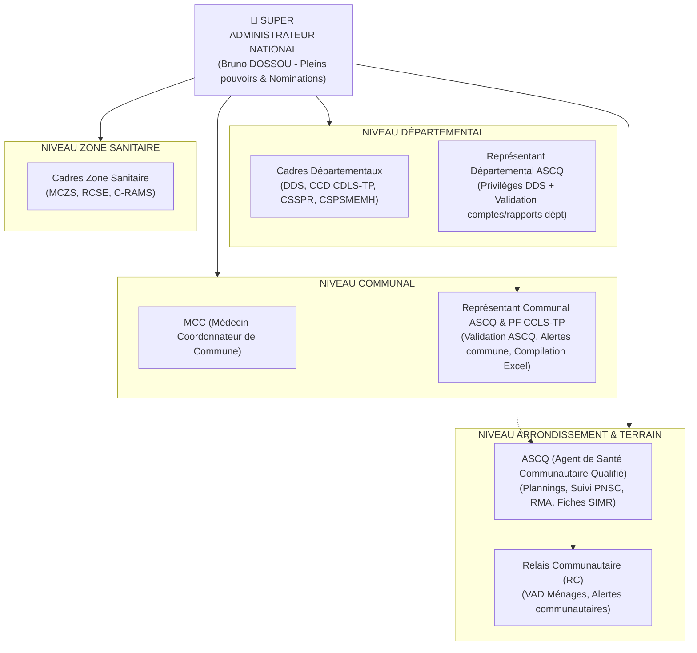
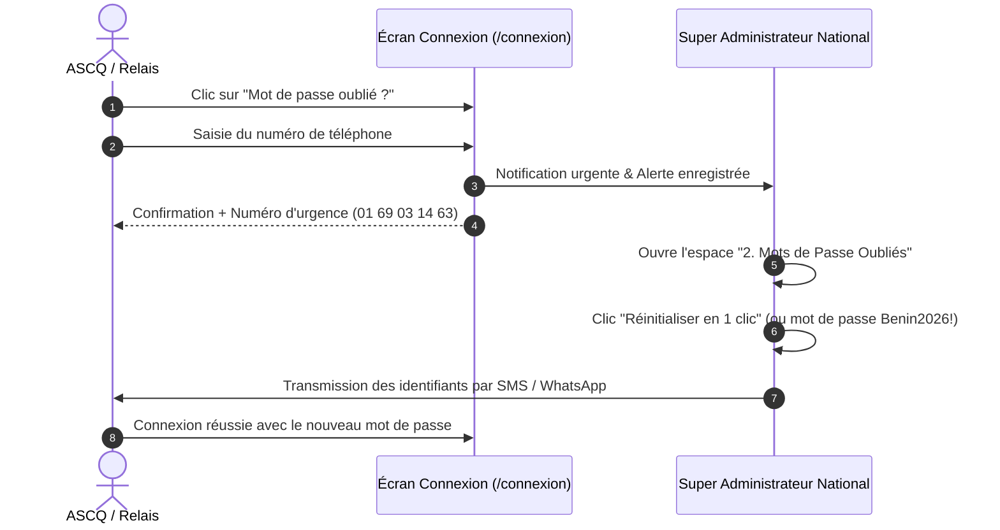

# 🇧🇯 REPUBLIQUE DU BENIN — MINISTERE DE LA SANTE
## POLITIQUE NATIONALE DE SANTE COMMUNAUTAIRE (PNSC)
# GUIDE OFFICIEL D'UTILISATION DE L'APPLICATION ASCQ BENIN
### Plateforme Numérique Intégrée de Gestion, de Surveillance Épidémiologique et de Suivi Opérationnel des Agents de Santé Communautaire Qualifiés (ASCQ) et des Relais Communautaires (RC)

---

## 📌 TABLE DES MATIERES

1. [Présentation Générale & Vision Institutionnelle](#1-présentation-générale--vision-institutionnelle)
2. [Installation Progressive Web App (PWA) & Mode Hors-Ligne](#2-installation-progressive-web-app-pwa--mode-hors-ligne)
3. [Architecture des Rôles & Matrice Officielle de Gouvernance](#3-architecture-des-rôles--matrice-officielle-de-gouvernance)
4. [Inscription, Connexion & Procédure « Mot de Passe Oublié »](#4-inscription-connexion--procédure--mot-de-passe-oublié-)
5. [Espace ASCQ : Manuel Opérationnel](#5-espace-ascq--manuel-opérationnel)
   - 5.1. Tableau de bord & Compteurs réels
   - 5.2. Gestion des Relais Communautaires (RC)
   - 5.3. Planning Hebdomadaire (Semaines 1 à 52)
   - 5.4. Espace Rapports (Les Deux Types de Rapports)
     - A. Type 1 : Suivi Hebdomadaire PNSC & Exports Excel Intelligents
     - B. Type 2 : Rapport Mensuel d'Activité (RMA) & Signature Exclusive
   - 5.5. Surveillance Épidémiologique SIMR & Fiches Terrain
   - 5.6. Espace Briefing & Calendrier Vaccinal du Bénin
   - 5.7. Permutations & Requêtes Administratives
   - 5.8. Bibliothèque Documentaire
6. [Espace Relais Communautaire (RC) : Manuel Terrain](#6-espace-relais-communautaire-rc--manuel-terrain)
7. [Espace Administration & Supervision du Périmètre](#7-espace-administration--supervision-du-périmètre)
   - 7.1. Supervision 360° & Recherche Universelle d'un ASCQ
   - 7.2. Modification de Fiche Profil avec Justification Obligatoire
   - 7.3. Nomination aux Postes Territoriaux (Accès Commune / Département)
   - 7.4. Centre de Réinitialisation des Mots de Passe Oubliés
   - 7.5. Validation Hiérarchique des Comptes
   - 7.6. Ordres de Mission & Diffusion d'Alertes
   - 7.7. Conseils Santé Citoyens & Bibliothèque
8. [Matrice des Droits & Tableau Récapitulatif](#8-matrice-des-droits--tableau-récapitulatif)
9. [Support Technique & Contacts d'Urgence](#9-support-technique--contacts-durgence)

---

## 1. PRÉSENTATION GÉNÉRALE & VISION INSTITUTIONNELLE

Dans le cadre de l'opérationnalisation de la **Politique Nationale de Santé Communautaire (PNSC)** du Bénin, l'application **ASCQ Bénin** constitue l'outil central de collecte, de supervision, d'alerte épidémiologique et de gestion administrative des **411 Agents de Santé Communautaire Qualifiés (ASCQ)** déployés sur l'ensemble du territoire national, ainsi que des milliers de **Relais Communautaires (RC)** qui leur sont rattachés.

### Objectifs Clés de la Plateforme :
* **Surveillance Intégrée des Maladies et Riposte (SIMR / One Health)** : Détection précoce au niveau communautaire des maladies à déclaration obligatoire (Fièvres hémorragiques, Choléra, Rougeole, Poliomyélite, Rage animale, etc.).
* **Gestion et Suivi des Relais Communautaires** : Enrôlement, validation et supervision des activités des relais par chaque ASCQ de tutelle.
* **Double Rapportage Structuré** :
  1. *Suivi Hebdomadaire PNSC* : Suivi logistique et RH (motos, ordinateurs, effectifs, salaires dus LLF/FADEC/SRHR, dotations).
  2. *Rapport Mensuel d'Activité (RMA)* : Suivi clinique des ménages, prise en charge intégrée communautaire (iCCM) et surveillance épidémiologique.
* **Gouvernance Hiérarchisée et Auditable** : Supervision par niveau (National, Départemental, Zone Sanitaire, Communal) avec traçabilité intégrale de toutes les modifications et nominations.

---

## 2. INSTALLATION PROGRESSIVE WEB APP (PWA) & MODE HORS-LIGNE

L'application est conçue comme une **Progressive Web App (PWA)**, optimisée pour fonctionner aussi bien sur smartphone Android, tablette que sur ordinateur, même avec une connectivité internet instable.

### Comment installer l'application sur son téléphone ou son ordinateur ?
1. Ouvrez le lien officiel de l'application dans votre navigateur (Google Chrome recommandé) : `https://ascq-benin.vercel.app`.
2. Un bouton vert **« 📲 Installer l'application »** apparaît automatiquement en haut de l'écran.
3. Cliquez sur **« Installer »** : l'icône **ASCQ Bénin** s'ajoute directement sur l'écran d'accueil de votre téléphone comme une application native.
4. L'application s'ouvre désormais en plein écran sans barre de navigateur.

### Fonctionnement Hors-Ligne (Offline-First) :
* Lorsque vous êtes en zone rurale sans réseau internet, vous pouvez continuer à saisir vos fiches de surveillance, plannings et rapports.
* Les données sont automatiquement stockées localement dans votre appareil (`LocalStorage`).
* Dès que vous retrouvez une connexion internet (Wi-Fi ou données mobiles), l'application synchronise automatiquement vos enregistrements avec la base de données centrale.

---

## 3. ARCHITECTURE DES RÔLES & MATRICE OFFICIELLE DE GOUVERNANCE



### 1. Super Administrateur National (Bruno DOSSOU)
* Seul habilité à **nommer** et **assigner les responsabilités** (Représentants départementaux, communaux, cadres).
* Accès universel 360° à tous les ASCQ et RC du Bénin.
* Modification des fiches avec journal d'audit et justification obligatoire.
* Réinitialisation directe des mots de passe en cas d'oubli.
* Publication des conseils santé et enrichissement de la bibliothèque nationale.

### 2. Niveau Départemental
* **Cadres (DDS, CCD CDLS-TP, CSSPR, CSPSMEMH)** : Consultation des rapports de toutes les communes du département, diffusion d'alertes sanitaires aux représentants départementaux et communaux.
* **Représentant Départemental (ASCQ nommé par l'Admin National)** : Privilèges de consultation identiques à la DDS, validation des comptes des ASCQ et PF du département, modification des profils communaux avec justification, validation des rapports départementaux.

### 3. Niveau Zone Sanitaire (MCZS, RCSE, C-RAMS)
* Consultation des rapports des communes de la zone sanitaire.
* Diffusion d'alertes sanitaires aux représentants communaux et ASCQ.

### 4. Niveau Communal
* **MCC (Médecin Coordonnateur de Commune)** : Consultation des rapports de sa commune, diffusion d'alertes au représentant communal. *(Rappel : le MCC ne signe pas les rapports des ASCQ)*.
* **Représentant Communal (ASCQ) & PF CCLS-TP** :
  * Validation des comptes ASCQ de la commune.
  * Diffusion d'alertes et notifications aux ASCQ de la commune.
  * Consultation et validation des rapports des ASCQ de la commune.
  * Génération et export de la **Compilation Communale Excel du Suivi Hebdo PNSC**.

### 5. ASCQ (Agent de Santé Communautaire Qualifié de base)
* Enrôlement, validation et gestion exclusive des comptes de ses **Relais Communautaires (RC)**.
* Élaboration du **Planning Hebdomadaire** (Semaines 1 à 52).
* Saisie du **Suivi Hebdomadaire PNSC** (gaps automatiques RH, motos, ordinateurs, salaires) et export individuel Excel.
* Saisie et signature tactile officielle du **Rapport Mensuel d'Activité (RMA)**.
* Déclaration des fiches d'alerte et de registre SIMR.

### 6. Relais Communautaire (RC)
* Rattaché à un seul ASCQ de tutelle.
* Renseigne les visites à domicile (VAD) et les fiches d'alerte urgente (décès, épidémies).

---

## 4. INSCRIPTION, CONNEXION & PROCÉDURE « MOT DE PASSE OUBLIÉ »

### A. Inscription sur la Plateforme
1. Rendez-vous sur la page d'inscription : `/inscription`.
2. Sélectionnez votre statut institutionnel parmi les sigles officiels :
   * **ASCQ**
   * **Cadres territoriaux** : `DDS`, `CCD_CDLS_TP`, `CSSPR`, `CSPSMEMH`, `MCZS`, `RCSE`, `C_RAMS`, `MCC`, `PF_CCLS_TP`.
3. **Note essentielle pour les Représentants** :
   Les **Représentants Départementaux** et **Représentants Communaux** doivent s'inscrire impérativement en tant qu'**ASCQ**. Une fois leur compte validé, le Super Administrateur National recherche leur nom et les nomme officiellement à leur poste via l'espace Périmètre.
4. Renseignez votre identité, votre numéro de téléphone (qui servira d'identifiant unique), votre zone géographique (Département, Zone Sanitaire, Commune, Arrondissement) et ajoutez votre **Photo de profil**.
5. Après inscription, le compte passe en statut `EN_ATTENTE` dans l'attente de la validation par l'autorité compétente.

### B. Connexion Sécurisée
1. Rendez-vous sur `/connexion`.
2. Saisissez votre **Numéro de téléphone** (Ex: `0197000000` ou `97000000`).
3. Saisissez votre **Mot de passe**.
4. Cliquez sur **« Se connecter »**. L'application vous redirige instantanément vers votre espace dédié selon votre rôle.

### C. Procédure Officielle en cas de « Mot de Passe Oublié »
Les comptes étant indexés sur les numéros de téléphone professionnels de terrain sans boîte e-mail personnelle, le système intègre une procédure de dépannage rapide :



1. **Sur l'écran de connexion** : Cliquez sur le lien **« Mot de passe oublié ? »**.
2. Renseignez votre numéro de téléphone enregistré et votre nom, puis cliquez sur **« Envoyer la demande »**.
3. **Notification immédiate** : Une alerte prioritaire est instantanément adressée au Super Administrateur National dans son tableau de bord.
4. **Assistance directe d'urgence** : En cas de besoin urgent sur le terrain, contactez directement la Coordination Nationale par appel ou WhatsApp au **01 69 03 14 63**.
5. **Réinitialisation par l'administrateur** : L'administrateur réinitialise vos accès (avec le mot de passe temporaire officiel `Benin2026!`) et vous communique vos nouveaux identifiants.

---

## 5. ESPACE ASCQ : MANUEL OPÉRATIONNEL

### 5.1. Tableau de Bord Personnel
Dès votre connexion sur `/espace-ascq`, votre tableau de bord présente vos chiffres **réels** issus de la base de données :
* Effectif réel de vos Relais Communautaires déclarés.
* Nombre de ménages couverts.
* Personnes touchées lors des visites.
* Accès direct aux alertes et aux fiches du mois.

### 5.2. Gestion des Relais Communautaires (RC)
* Accessible via l'onglet **« Mes Relais »** (`/espace-ascq/relais`).
* **Ajouter un RC** : Cliquez sur « Ajouter un relais », renseignez son nom, prénom, numéro de téléphone, village d'intervention et nombre de ménages sous sa responsabilité.
* **Validation & Contrôle** : Chaque ASCQ est le seul habilité à valider, modifier ou suspendre le compte de ses propres RC.

### 5.3. Planning Hebdomadaire (Semaines 1 à 52)
Conformément aux directives de la coordination nationale, le planning des activités des ASCQ est **strictement hebdomadaire** :
* Accessible via **« Planning »** (`/espace-ascq/planning`).
* Sélectionnez l'**Année** et la **Semaine** (de 1 à 52). Les dates exactes du Lundi au Dimanche sont calculées automatiquement (ex: *Du lundi 20/10/2026 au dimanche 26/10/2026*).
* Grille journalière du **Lundi au Samedi** :
  * *Lundi* : Supervision et collecte des fiches auprès des RC.
  * *Mardi* : Visites à domicile (VAD) ciblées (femmes enceintes, nouveau-nés, vaccination).
  * *Mercredi* : Séances de sensibilisation IEC/CCC et hygiène.
  * *Jeudi* : Prise en charge intégrée communautaire (iCCM) et soins.
  * *Vendredi* : Réunion de coordination hebdomadaire avec les RC et consolidation des données.
  * *Samedi* : Rattrapage des référés et synthèse hebdomadaire.
* **Signature tactile manuscrite** : Signez directement sur votre écran dans le cadre dédié.
* **Impression** : Bouton d'impression formaté pour produire le document officiel papier.

### 5.4. Espace Rapports : Les Deux Types de Rapports
L'application propose deux rapports distincts accessibles via un bandeau d'onglets :

```
[ 📊 1. Suivi Hebdo PNSC ]  <=======>  [ 📑 2. Rapport Mensuel d'Activité (RMA) ]
```

#### A. Type 1 — Suivi Hebdomadaire PNSC (`/espace-ascq/rapport-hebdo-pnsc`)
Ce rapport assure le monitoring des ressources et de la logistique du programme PNSC :
1. **Localisation** : Département, Commune, Arrondissement.
2. **Ressources Humaines** :
   * Besoins selon les normes.
   * Effectif fonctionnel sur le terrain.
   * $\rightarrow$ **Gap RH calculé automatiquement** ($\text{Besoins} - \text{Fonctionnel}$).
3. **Moyens de déplacement (Motos)** :
   * Motos mises à disposition.
   * Motos fonctionnelles.
   * $\rightarrow$ **Gap Moto calculé automatiquement**.
4. **Outils informatiques (Ordinateurs / Tablettes)** :
   * Ordinateurs mis à disposition.
   * Ordinateurs fonctionnels.
   * $\rightarrow$ **Gap Ordinateur calculé automatiquement**.
5. **Rémunérations dues (Arriérés de salaire en mois)** :
   * Nombre de mois dus sur financement **LLF**.
   * Nombre de mois dus sur financement **FADEC**.
   * Nombre de mois dus sur financement **SRHR**.
   * $\rightarrow$ **Cumul total des mois d'arriérés calculé automatiquement**.
6. **Dotations reçues** :
   * Forfait internet reçu (*Oui / Non* + volume/détails).
   * Dotation en carburant reçue (*Oui / Non* + montant/litres).
   * Autres matériels reçus.
7. **Activités, Difficultés et Suggestions**.
8. **Signature tactile exclusive de l'ASCQ**.
9. **Génération & Exports Excel (.xls) intelligents** :
   * **Bouton « Exporter ma Fiche Individuelle Excel »** : Télécharge instantanément la fiche individuelle de l'ASCQ aux couleurs officielles de la République du Bénin.
   * **Bouton « Exporter la Compilation Communale Excel »** *(Réservé au Représentant Communal ASCQ et au PF CCLS-TP)* : Consolide l'ensemble des arrondissements de la commune avec ligne des **Totaux automatiques**.

#### B. Type 2 — Rapport Mensuel d'Activité (RMA) (`/espace-ascq/rapport-mensuel`)
* Suivi clinique et communautaire mensuel : Relais actifs, ménages visités, enfants 0-5 ans suivis, femmes enceintes orientées, cas de paludisme (TDR positifs/négatifs), diarrhées, malnutrition et cas référés.
* Surveillance One Health et santé animale (morsures de chiens suspectes de rage, mortalités anormales d'animaux).
* **Règle Institutionnelle sur la Signature du RMA :**
  Le cadre de signature du MCC a été **définitivement supprimé**. L'ASCQ est l'**unique signataire officiel** de son rapport d'activité. Le document engage la responsabilité personnelle et professionnelle de l'ASCQ avec signature tactile et horodatage.

### 5.5. Surveillance Épidémiologique SIMR
* Accessible via l'onglet **« Surveillance »** (`/fiches`).
* Permet d'enregistrer en temps réel :
  * Une **Fiche d'Alerte Urgente** (suspicion de maladie à potentiel épidémique, décès communautaire).
  * Une **Fiche Registre** récapitulant les activités périodiques.

### 5.6. Espace Briefing & Calendrier Vaccinal du Bénin
* Accessible via **« Guide SIMR & Vaccins »** (`/briefing`).
* **Accès protégé** : Strictement réservé aux utilisateurs connectés.
* Contient le **Calendrier vaccinal officiel en vigueur au Bénin (PEV)** :
  * À la naissance : BCG, VPO-0, Hépatite B naissance.
  * À 6, 10 et 14 semaines : Pentavalent, Pneumo, VPO, VPI, Rotavirus.
  * À 9 et 15 mois : VAA (Fièvre Jaune), Rougeole-Rubéole (RR1, RR2), Méningite.
  * À 9 ans : Vaccin anti-HPV (cancer du col de l'utérus) pour les jeunes filles.
* **Définitions communautaires des maladies SIMR** :
  * Maladies à potentiel épidémique (Choléra, Rougeole, Fièvres hémorragiques Lassa/Ebola/Marburg, Méningite, Fièvre jaune).
  * Maladies ciblées pour l'éradication (Poliomyélite, Tétanos néonatal, Dracunculose).
  * Événements One Health (Morsures suspectes de rage, charbon bactéridien, grippe aviaire).

---

## 6. ESPACE RELAIS COMMUNAUTAIRE (RC) : MANUEL TERRAIN

L'interface des Relais Communautaires est épurée pour un usage tactile rapide sur le terrain :
1. **Mon Secteur / Village** : Affichage du nom du village et du nombre de ménages assignés par l'ASCQ.
2. **Déclarer une Alerte Immédiate** :
   * Décès maternel (femme enceinte ou ayant accouché il y a moins de 42 jours).
   * Décès néonatal (nouveau-né de moins de 28 jours).
   * Cas de diarrhée aqueuse abondante (suspicion choléra).
   * Fièvre avec saignements anormaux.
   * Morsure suspecte par un animal errant.
3. **Visites à Domicile (VAD)** : Enregistrement du nombre de ménages visités dans la semaine et orientation des enfants non vaccinés ou malades vers l'ASCQ.

---

## 7. ESPACE ADMINISTRATION & SUPERVISION DU PÉRIMÈTRE

Accessible aux Administrateurs et Cadres habilités via `/admin`.

### 7.1. Supervision 360° & Recherche Universelle d'un ASCQ
Dans le sous-onglet **« 1. Recherche & Dossier 360° ASCQ »** de l'espace Périmètre :
* Tapez les premières lettres du nom d'un ASCQ ou son numéro de téléphone.
* Cliquez sur sa carte pour afficher son **Dossier 360° exhaustif** :
  * Informations personnelles et professionnelles complètes.
  * Territoire et zone d'intervention.
  * Liste complète de ses Relais Communautaires rattachés.
  * Historique de ses Suivis PNSC et Rapports RMA.
  * Journal des audits et modifications passées.

### 7.2. Modification de Fiche Profil avec Justification Obligatoire
1. Cliquez sur le bouton **« ✏️ Modifier (Justifié) »** sur la fiche de l'ASCQ.
2. Mettez à jour les champs souhaités (téléphone, commune, arrondissement, source de financement LLF/FADEC, statut).
3. **Justification Administrative Obligatoire :**
   Vous devez obligatoirement remplir le champ **« Motif & Justification Administrative »** (ex: *Mutation sur arrêté préfectoral n°..., régularisation de la source de financement...*).
   L'application refuse l'enregistrement si la justification est absente ou inférieure à 5 caractères.
4. L'opération est immédiatement enregistrée dans le journal d'audit national avec horodatage et nom de l'administrateur.

### 7.3. Nomination aux Postes Territoriaux (Accès Commune / Département)
Réservé exclusivement au **Super Administrateur National** :
1. Cliquez sur le bouton **« 👑 Nommer au poste »**.
2. Choisissez le poste et le territoire :
   * **Représentant Communal (ASCQ)** : Donne automatiquement accès aux rapports, alertes et données de **toute sa Commune**.
   * **Représentant Départemental (ASCQ)** : Donne automatiquement accès aux rapports, alertes et données de **tout son Département**.
   * **PF CCLS-TP** : Suivi PNSC communal.
3. Renseignez la **Référence de l'Acte de Nomination** (ex. *Décision de nomination n°... du Super Admin National*).
4. Cliquez sur **« Confirmer la nomination »** : l'agent reçoit une notification officielle et ses accès de données sont instantanément élargis.

### 7.4. Centre de Réinitialisation des Mots de Passe Oubliés
* Dans le sous-onglet **« 🔑 2. Mots de Passe Oubliés »** :
  * Consultez la liste des demandes envoyées par les agents depuis l'écran de connexion.
  * Cliquez sur **« Réinitialiser en 1 clic »** : l'application pré-remplit la modale de réinitialisation.
  * Définissez un mot de passe ou cliquez sur **« Utiliser "Benin2026!" »**.
  * Cliquez sur **« Valider le nouveau mot de passe »**.
  * Cliquez sur **« 📋 Copier le message prêt pour SMS / WhatsApp »** et collez-le directement dans votre messagerie pour l'envoyer à l'agent.

### 7.5. Validation Hiérarchique des Comptes
Dans l'onglet **« Comptes & ASCQ »** :
* Les **Représentants Communaux** et **PF CCLS-TP** valident les inscriptions des ASCQ de leur commune.
* Les **Représentants Départementaux** valident les comptes des ASCQ et PF de leur département.
* Le **Super Administrateur National** peut valider l'ensemble des comptes du territoire.

### 7.6. Ordres de Mission & Diffusion d'Alertes
* Diffusez des consignes opérationnelles ciblées (Campagne de ratissage vaccinal, riposte épidémique immédiate, réunions de coordination).
* L'alerte est instantanément transmise sur les téléphones des agents concernés.

---

## 8. MATRICE DES DROITS & TABLEAU RÉCAPITULATIF

| Rôle / Profil | Périmètre d'Accès | Validation Comptes | Rapports Visibles | Export Excel PNSC | Nomination & Rôles |
| :--- | :--- | :--- | :--- | :--- | :--- |
| **Super Administrateur National** | 🇧🇯 National (Tout) | Tous les comptes | Tous les rapports du Bénin | Individuel & National | **Pouvoir Exclusif** |
| **DDS / CCD CDLS-TP / Cadres Dép.** | Département | Consultation | Toutes les communes du Dépt | Consultation | Non |
| **Représentant Départemental ASCQ** | Département | ASCQ & PF du Dépt | Toutes les communes du Dépt | Compilation Dépt | Non |
| **MCZS / RCSE / Cadres Zone** | Zone Sanitaire | Consultation | Communes de la Zone | Consultation | Non |
| **MCC (Médecin Coordonnateur)** | Commune | Consultation | ASCQ de la Commune | Consultation | Non |
| **Représentant Communal ASCQ** | Commune | ASCQ de la Commune | Tous les ASCQ de la Commune | **Compilation Communale** | Non |
| **PF CCLS-TP** | Commune | ASCQ de la Commune | Tous les ASCQ de la Commune | **Compilation Communale** | Non |
| **ASCQ (Terrain)** | Arrondissement | Ses propres RC | Ses propres rapports | **Fiche Individuelle** | Non |
| **Relais Communautaire (RC)** | Village / Secteur | Aucun | Ses propres fiches VAD | Non | Non |

---

## 9. SUPPORT TECHNIQUE & CONTACTS D'URGENCE

Pour toute question technique, difficulté de connexion, déclaration d'anomalie ou assistance d'urgence sur le terrain :

* **Super Administrateur National** : **Bruno DOSSOU**
* **Téléphone & WhatsApp Officiel** : **+229 01 69 03 14 63**
* **Plateforme Web Officielle** : [https://ascq-benin.vercel.app](https://ascq-benin.vercel.app)
* **Ministère de la Santé — République du Bénin**

---
*Document officiel établi pour servir de guide de référence à tous les acteurs de la Politique Nationale de Santé Communautaire (PNSC) du Bénin.*
